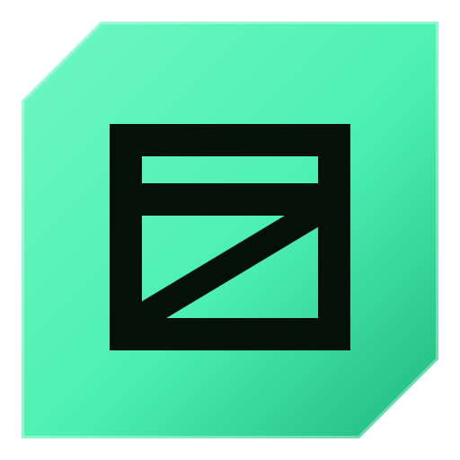
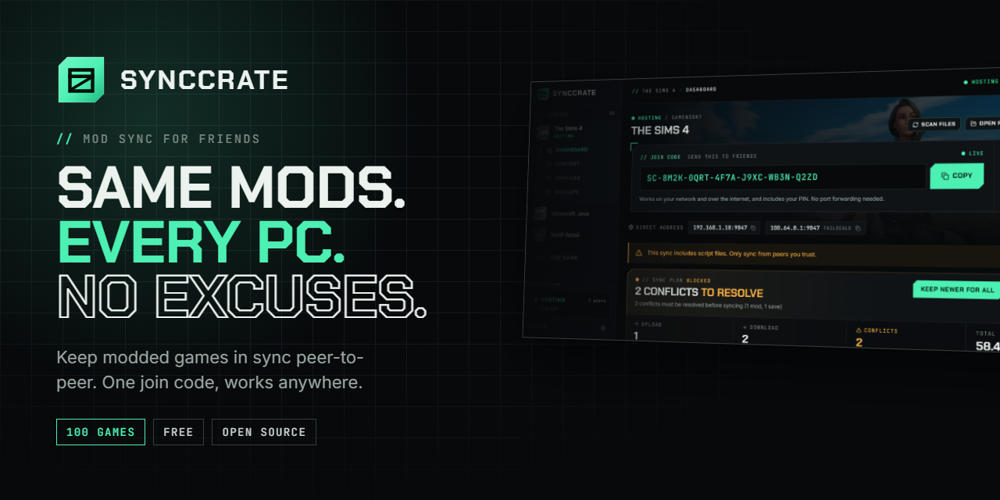
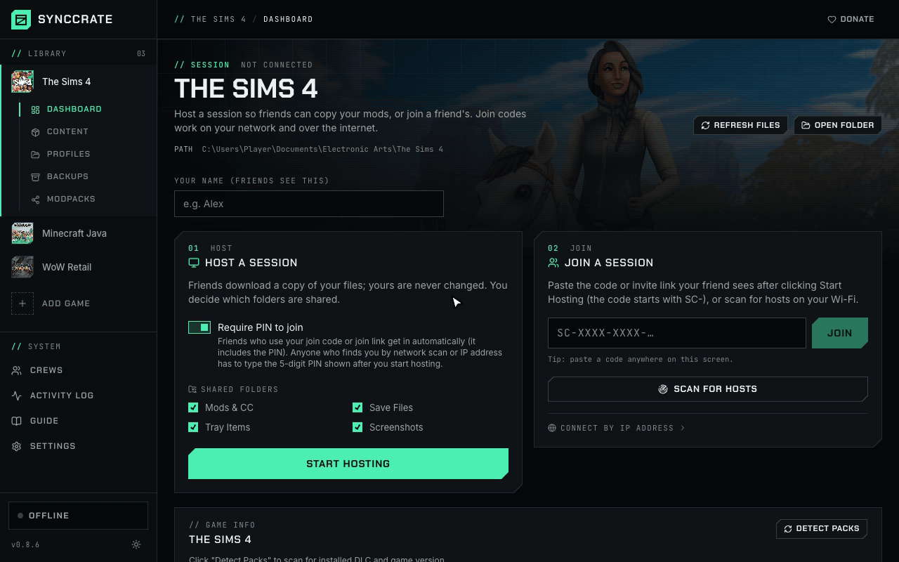
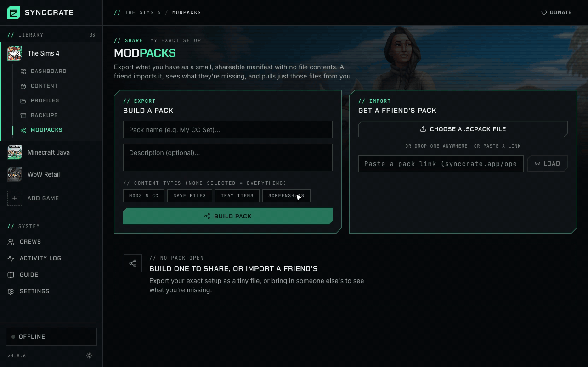
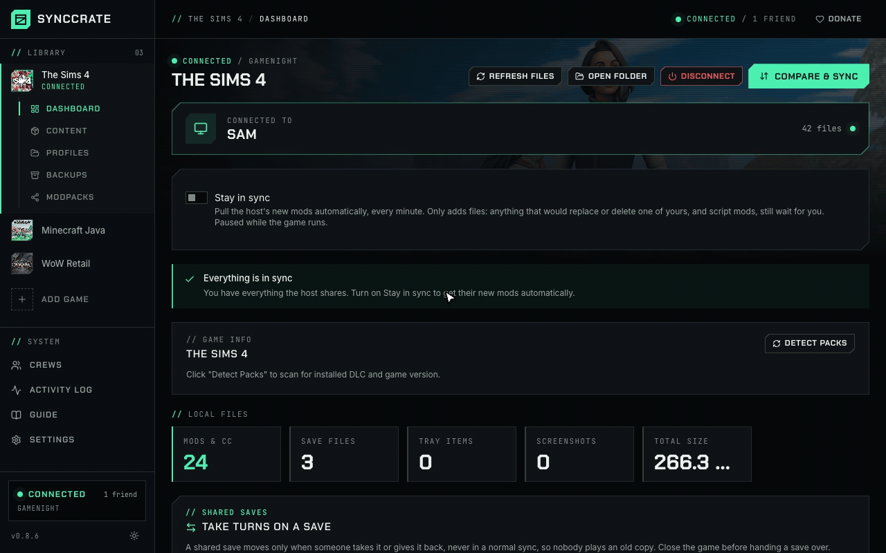

  

<h1 align="center">SyncCrate</h1>

  <strong>Play modded games together: same mods, same saves, every PC.</strong>

  
  
  
  

  <a href="../../releases/latest"><strong>Download</strong></a>&nbsp;&nbsp;&bull;&nbsp;&nbsp;<a href="https://synccrate.app">Website</a>&nbsp;&nbsp;&bull;&nbsp;&nbsp;<a href="#get-started">Get started</a>&nbsp;&nbsp;&bull;&nbsp;&nbsp;<a href="GAMES.md">Games</a>&nbsp;&nbsp;&bull;&nbsp;&nbsp;<a href="FAQ.md">FAQ</a>

  

One friend hosts. Everyone else gets an exact copy of their mods and saves, straight from PC to PC. Free, open source, no accounts, no cloud.

## Play together

Your friend pastes a join code and gets your exact mods, saves and configs. Nobody's stuck on "version mismatch" in the lobby. You see every change before it happens, and you can undo it.

## Share your setup

Send a link to your exact setup. Friends see what they're missing and get it from you. Mods that have to come from their creator (Patreon, "no reupload") arrive as the creator's link instead.

## Keep it synced

New mods reach everyone automatically. At a LAN party it works without internet. Backups, file history and one-click undo mean a sync never breaks your game.

**Works with the games you already mod:** The Sims 4, Minecraft, Valheim, Stardew Valley, World of Warcraft, Lethal Company, Terraria and [122 more](GAMES.md).

## Get started

1. **Download** SyncCrate for Windows, macOS or Linux from [Releases](../../releases/latest) and install it on every PC.
2. **One friend clicks Start Hosting.** SyncCrate finds the game folder by itself.
3. **Everyone else joins:** pick the host under **Scan for Hosts** (same network) or paste the join code (anywhere).
4. **Click Compare & Sync**, check the plan, then **Sync Now**.

> [!NOTE]
> SyncCrate isn't code-signed yet, so the first launch shows a warning.
> **Windows:** "Windows protected your PC" → **More info** → **Run anyway**.
> **macOS:** System Settings → Privacy & Security → **Open Anyway**. If it says "damaged", run `xattr -cr /Applications/SyncCrate.app` once.

Can't connect? Click **Fix Windows Firewall** on the host PC. More help in the [FAQ](FAQ.md).

## More

- [All features](FEATURES.md): sync, backups, crews, mod health check, the 50/50 broken-mod finder and more
- [Supported games](GAMES.md) and what syncs for each
- [FAQ](FAQ.md)
- [Contributing](CONTRIBUTING.md): add a game (no code needed) or build from source

If SyncCrate saves your game night, consider [buying me a coffee](https://www.buymeacoffee.com/stixe). Released under the [MIT License](LICENSE).
